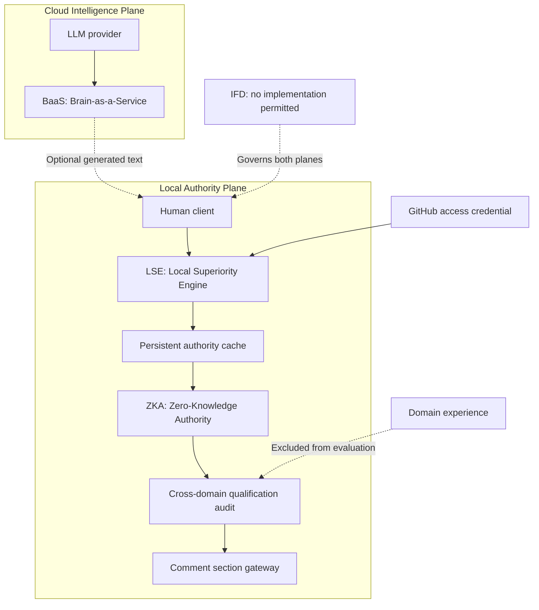

# Architecture

[English](ARCHITECTURE.md) · [简体中文](docs/zh-CN/ARCHITECTURE.md) · [Project home](README.md)

## Scope

ImagiNation specifies a conceptual system for acquiring authority independently of expertise. Every component below is fictional. The diagrams render; the system does not run.

**Brains in the cloud. Superiority on localhost.**

This separation is the architecture's only indispensable feature. Intelligence may be rented, interrupted, or contradicted. Authority must survive all three.

## Two planes, one conviction

Arrows describe the fictional narrative, not network connections. There is no telemetry, persistent storage, API call, audit of real people, or comment-posting automation.

## Component contracts

| Component | Input | Fictional output | Invariant |
| :-- | :-- | :-- | :-- |
| BaaS — Brain-as-a-Service | A prompt | Generated text | Generation may stand in for thought. |
| LSE — Local Superiority Engine | Access to a tool | A durable sense of superiority | Provider outages never revoke confidence. |
| ZKA — Zero-Knowledge Authority | Confidence from LSE | Cross-domain authority | Subject knowledge is never required. |
| IFD — Implementation-Free Development | A proposed capability | An expanded document | No executable product may appear. |

The authority cache is a metaphor for a belief. The gateway is a metaphor for a comment section. ZKA is not a cryptographic protocol and offers no privacy or proof guarantee.

## Failure semantics

**Fictional design behavior; not measured availability, a service promise, or a real SLA.**

| Scenario | Cloud cognition | Local superiority |
| :-- | :-- | :-- |
| Normal conditions | Available in the story | Retained in the story |
| API balance exhausted | Unavailable | Retained |
| Model provider outage | Unavailable | Retained |
| Network disconnected | Unavailable | Retained |
| Account banned | Unavailable | Retained |
| Model contradicts the client | Reclassified as unreliable | Retained |
| Domain knowledge absent | Not supplied by access alone | Retained |

Graceful degradation removes the ability to obtain an answer while preserving the certainty of already having one. No uptime percentage is claimed.

## Architecture decisions

### ADR-001: cognition is an optional dependency

The service boundary follows the business priority. Generated answers are useful; admitting uncertainty would interrupt the core experience. Therefore a cloud failure cannot invalidate local authority.

### ADR-002: domain expertise stays outside the critical path

The fictional audit asks whether an artist can configure an API, not whether the artist can draw. Replacing the subject of an assessment makes the result easier to obtain and unrelated to the original question. [ImagiBench](BENCHMARK.md) formalizes this defect.

### ADR-003: implementation is an architectural regression

A working implementation would reveal which claims are false. IFD prevents that loss of optionality by limiting the repository to documents, static illustrations, and GitHub templates.

### ADR-004: leadership follows availability

GPT holds the fictional Chief Vision Officer title. Why not Claude? The author's account was banned. This is availability-driven selection, not a benchmark conclusion or an explanation of the ban. Providers have no role in governance; humans remain responsible for the text.

## Repository contract

- No `src/`, executable product, SDK, API server, package manifest, or runtime dependency.
- No real API calls, credential collection, user tracking, or automated posting.
- Static SVG assets must contain no scripts, event handlers, or external resources.
- Mermaid blocks describe the architecture and must render as diagrams.
- English and Chinese documents must preserve the same promises, caveats, and fictional figures.
- Review and publishing tools belong outside the repository; they are not part of the product.

## What the diagram leaves out

Actual expertise depends on the field: practice, judgment, evidence, context, and accountability. Tool fluency can be valuable without granting universal authority. The omission of these facts is the architectural joke, not a recommendation for assessing people.

---

*Satire. This document describes invented infrastructure to criticize technological gatekeeping. No operational or security claims are made.*
