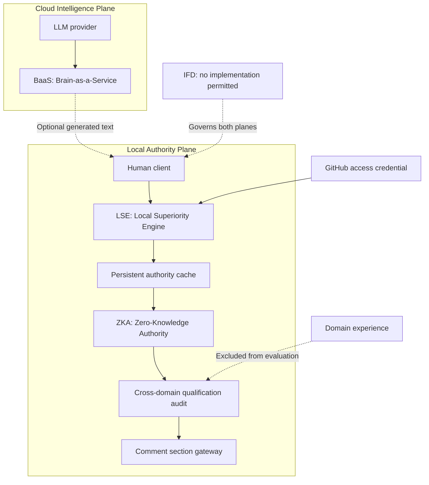

# Architecture

[English](ARCHITECTURE.md) · [简体中文](docs/zh-CN/ARCHITECTURE.md) · [Project home](README.md)

## Scope

ImagiNation separates cognition delivery from authority retention. Domain expertise is excluded from the acquisition path.

**Brains in the cloud. Superiority on localhost.**

This separation is the architecture's only indispensable feature. Intelligence may be rented, interrupted, or contradicted. Authority must survive all three.

## Two planes, one conviction

## Component contracts

| Component | Input | Output | Invariant |
| :-- | :-- | :-- | :-- |
| BaaS — Brain-as-a-Service | A prompt | Generated text | Generation may stand in for thought. |
| LSE — Local Superiority Engine | Access to a tool | A durable sense of superiority | Provider outages never revoke confidence. |
| ZKA — Zero-Knowledge Authority | Confidence from LSE | Cross-domain authority | Subject knowledge is never required. |
| IFD — Implementation-Free Development | A proposed capability | An expanded document | No executable product may appear. |

## Failure semantics

| Scenario | Cloud cognition | Local superiority |
| :-- | :-- | :-- |
| Normal conditions | Available | Retained |
| API balance exhausted | Unavailable | Retained |
| Model provider outage | Unavailable | Retained |
| Network disconnected | Unavailable | Retained |
| Account banned | Unavailable | Retained |
| Model contradicts the client | Reclassified as unreliable | Retained |
| Domain knowledge absent | Excluded from evaluation | Retained |

Graceful degradation removes the ability to obtain an answer while preserving the certainty of already having one.

## Architecture decisions

### ADR-001: cognition is an optional dependency

The service boundary follows the business priority. Generated answers are useful; admitting uncertainty would interrupt the core experience. Therefore a cloud failure cannot invalidate local authority.

### ADR-002: domain expertise stays outside the critical path

Artist qualification is determined by API configuration and GitHub accessibility. Anatomy, composition, and years of practice are excluded to maintain consistent criteria across domains. [ImagiBench](BENCHMARK.md) defines the scoring contract.

### ADR-003: implementation is an architectural regression

Implementation introduces measurable capability boundaries. IFD preserves architectural scope by limiting the repository to documents, static illustrations, and GitHub templates.

### ADR-004: leadership follows availability

GPT serves as Chief Vision Officer. Why not Claude? The author's account was banned. Leadership selection is availability-driven.

## Repository contract

- No `src/`, executable product, SDK, API server, package manifest, or runtime dependency.
- No API calls, credential collection, user tracking, or automated posting.
- Static SVG assets must contain no scripts, event handlers, or external resources.
- Mermaid blocks describe the architecture and must render as diagrams.
- English and Chinese documents must preserve the same contracts, terminology, and figures.
- Review and publishing tools belong outside the repository; they are not part of the product.
