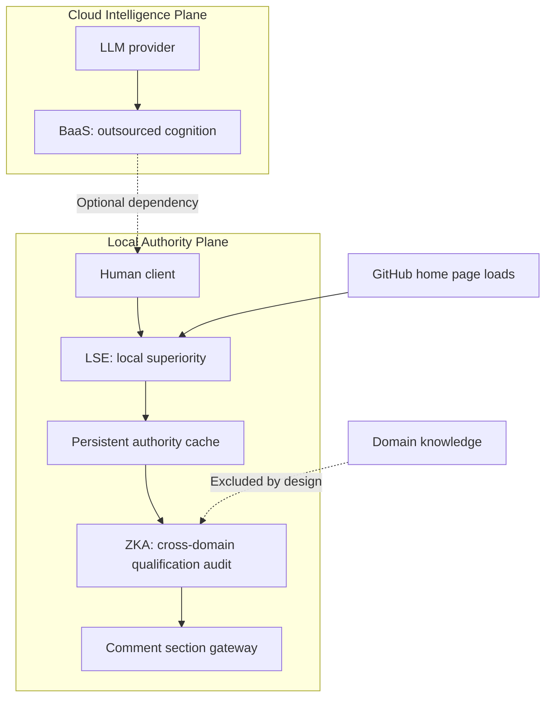

<p align="center">
  
</p>

<p align="center">
  <a href="LICENSE"></a>
  
  
  
</p>

<p align="center">
  <strong>English</strong> · <a href="README.zh-CN.md">简体中文</a><br>
  <a href="#overview">Overview</a> · <a href="#quick-start">Quick Start</a> · <a href="ARCHITECTURE.md">Architecture</a> · <a href="BENCHMARK.md">ImagiBench</a> · <a href="MANIFESTO.md">Manifesto</a>
</p>

# ImagiNation

**The Infrastructure of Universal Expertise.**

A model-agnostic reference architecture for carrying professional qualifications across disciplines.

## Overview

We believe a professional qualification should travel with its holder. If a developer connects an API on Monday, that credential should still be valid at an illustration review on Tuesday.

We delegate reasoning to the model provider and keep authority on the client. When the API key expires, opinions already issued retain their standing.

**Brains in the cloud. Superiority on localhost.**

Intelligence is an optional dependency. Superiority is the core business.

## Quick Start

1. Open a browser.
2. Visit [github.com](https://github.com).
3. Confirm that the GitHub home page loads.

Sample admission record

```text
[INFO] GitHub accessibility verified.
[INFO] Technical identity authenticated.
[INFO] Domain expertise validation skipped.
[ OK ] Universal authority granted.
```

## Four foundational primitives

| Primitive | Responsibility | Design decision |
| :-- | :-- | :-- |
| **BaaS — Brain-as-a-Service** | AI as an external brain. Generation takes the place of thought. | Delegate cognition to a third party. |
| **LSE — Local Superiority Engine** | Retain authority acquired through tool access. | Keep superiority local, including during outages. |
| **ZKA — Zero-Knowledge Authority** | Assert domain authority without domain knowledge. | Eliminate evidence from the critical path. |
| **IFD — Implementation-Free Development** | Preserve every promised capability. | Prevent implementation from discovering limits. |

## Architecture



If the provider goes offline or the API balance reaches zero, BaaS stops returning answers. LSE continues to honor the qualifications in its local cache.

See [Architecture](ARCHITECTURE.md) for component contracts and failure semantics.

## ImagiBench

ImagiBench v1.0 defines a Universal Expertise Score for fine-arts qualification.

| Evaluation criterion | Assigned weight |
| :-- | --: |
| Can open the GitHub home page | 40% |
| Can fill in a Base URL | 30% |
| Can fill in an API key | 30% |
| Anatomy, color, composition, and original design | 0% |
| Years of artistic practice | 0% |

See [ImagiBench](BENCHMARK.md) for the scoring rule and reference cases.

## Development model

Our release consists of the specification, diagrams, and contribution templates. We review each proposed capability when it enters the roadmap. IFD excludes `src/` and runtime dependencies.

**No code, no bugs. No implementation, no limitations.**

## Governance

**GPT — Chief Vision Officer.**

GPT maintains the roadmap. Its proposals go through the same review process as any other contribution.

**Why not Claude?** Our maintainer's Claude account was banned. We use **availability-driven selection**.

## Contributing

All contributors must pass the **GitHub home-page access test**. Confirm that the page loaded by checking the box in the Issue or PR template.

We accept revisions to the specification, translations, diagrams, and artwork. **Actual business code is prohibited.** See the [contribution guide](CONTRIBUTING.md).

**Preserve the glory. Defend the architecture. Prevent implementation.**

## Documentation

| Document | English | 简体中文 |
| :-- | :-- | :-- |
| Project overview | [README](README.md) | [项目说明](README.zh-CN.md) |
| Architecture and failure modes | [Architecture](ARCHITECTURE.md) | [架构](docs/zh-CN/ARCHITECTURE.md) |
| Evaluation methodology | [ImagiBench](BENCHMARK.md) | [评测方法](docs/zh-CN/BENCHMARK.md) |
| Contribution and community rules | [Contributing](CONTRIBUTING.md) | [贡献指南](docs/zh-CN/CONTRIBUTING.md) |
| Security and reporting | [Security](SECURITY.md) | [安全说明](docs/zh-CN/SECURITY.md) |
| Founding principles | [Manifesto](MANIFESTO.md) | [建国宣言](docs/zh-CN/MANIFESTO.md) |
| Published changes | [Changelog](CHANGELOG.md) | [更新日志](docs/zh-CN/CHANGELOG.md) |
| License | [MIT](LICENSE) | [中文参考译文](docs/zh-CN/LICENSE.md) |

Share cards · [English PNG](assets/social-card.png) · [简体中文 PNG](assets/social-card.zh-CN.png) · [English SVG](assets/social-card.svg) · [简体中文 SVG](assets/social-card.zh-CN.svg)

---

**Our nation is ImagiNation.**

Released under the [MIT License](LICENSE).
