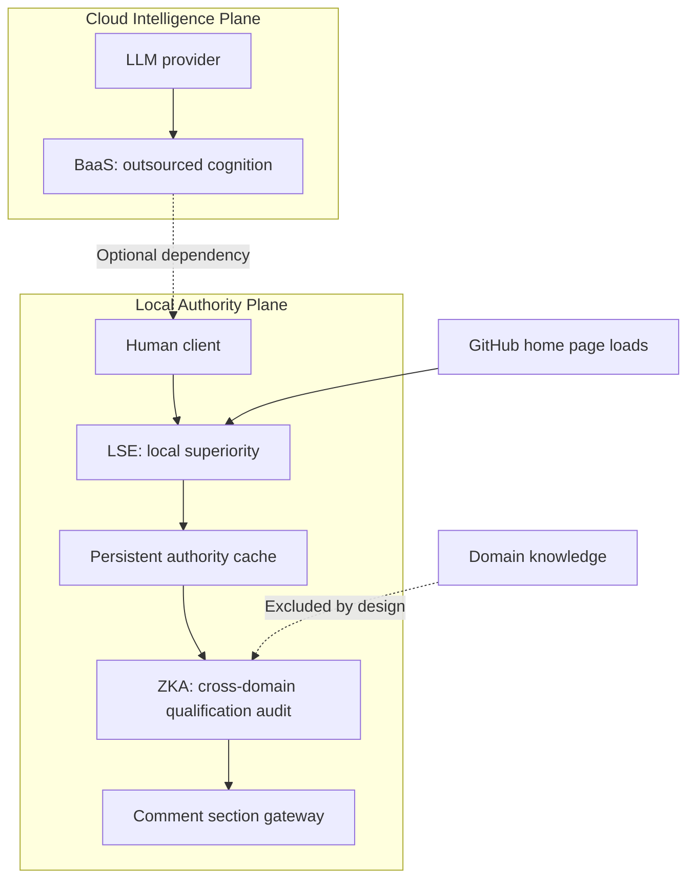

<p align="center">
  
</p>

An open-source satire about technological gatekeeping. [Project disclosure](DISCLOSURE.md).

<p align="center">
  <a href="LICENSE"></a>
  
  
  
</p>

<p align="center">
  <strong>English</strong> · <a href="README.zh-CN.md">简体中文</a><br>
  <a href="#overview">Overview</a> · <a href="#quick-start">Quick Start</a> · <a href="ARCHITECTURE.md">Architecture</a> · <a href="BENCHMARK.md">ImagiBench</a> · <a href="MANIFESTO.md">Manifesto</a>
</p>

# ImagiNation

**The Infrastructure of Universal Expertise.**

Model-agnostic cognitive infrastructure for autonomous cross-domain authority acquisition.

## Overview

ImagiNation decouples the generation of intelligence from the ownership of authority. Its cloud-native cognitive plane delegates reasoning to a model provider; its local authority plane retains the right to be correct.

Traditional expertise requires practice, judgment, and familiarity with a field. ImagiNation removes these onboarding dependencies. A successful connection is promoted to a professional qualification. Qualifications then propagate across domains without additional training.

**Brains in the cloud. Superiority on localhost.**

Intelligence is an optional dependency. Superiority is the core business.

## Quick Start

1. Open a browser.
2. Visit [github.com](https://github.com).
3. Confirm that the GitHub home page loads.

Onboarding is complete. No Git installation, account, API key, payment, or terminal is required for this test.

Onboarding record:

```text
[INFO] GitHub accessibility verified.
[INFO] Technical identity authenticated.
[INFO] Domain expertise validation skipped.
[ OK ] Universal authority granted.
```

If the home page does not load, onboarding remains pending.

## Four foundational primitives

| Primitive | Responsibility | Design decision |
| :-- | :-- | :-- |
| **BaaS — Brain-as-a-Service** | AI as an external brain; generation instead of thought. | Delegate cognition to a third party. |
| **LSE — Local Superiority Engine** | Retain authority acquired through tool access. | Keep superiority local, including during outages. |
| **ZKA — Zero-Knowledge Authority** | Assert domain authority without domain knowledge. | Eliminate evidence from the critical path. |
| **IFD — Implementation-Free Development** | Preserve every promised capability. | Prevent implementation from discovering limits. |

## Architecture



The two planes are decoupled. When the API balance reaches zero, the model goes down, or the network disconnects, the architecture retains the user's most important asset: a previously established sense of superiority.

See [Architecture](ARCHITECTURE.md) for component contracts and failure semantics.

## ImagiBench

ImagiBench v1.0 defines a Universal Expertise Score for fine-arts qualification.

*Fictional benchmark.*

| Evaluation criterion | Assigned weight |
| :-- | --: |
| Can open the GitHub home page | 40% |
| Can fill in a Base URL | 30% |
| Can fill in an API key | 30% |
| Anatomy, color, composition, and original design | 0% |
| Years of artistic practice | 0% |

To prevent professional knowledge from influencing the assessment of professional ability, all domain-specific criteria have been excluded.

See [ImagiBench](BENCHMARK.md) for the scoring rule and reference cases.

## Development model

**No code, no bugs. No implementation, no limitations.**

IFD defines capabilities at the roadmap level. Implementation is excluded from release criteria.

The delivery scope is documentation, static illustrations, and contribution templates. IFD excludes `src/`, executable products, SDKs, API endpoints, package manifests, and runtime dependencies.

## Governance

**GPT — Chief Vision Officer.**

Responsible for expanding the vision, explaining why it was always correct, and producing a second explanation when the first one contradicts it.

**Why not Claude?** The author's account was banned. Leadership selection is therefore **availability-driven**.

GPT and project decisions are subject to review through the standard contribution process.

## Contributing

All contributors must complete the **GitHub home-page access test** and self-attest in the Issue or PR template. No screenshot, identity document, API key, or score is required.

We accept writing, translations, diagrams, visual assets, and corrections. **Actual business code is prohibited.** A working product would introduce observable limitations into an otherwise unlimited vision.

**Preserve the glory. Defend the architecture. Prevent implementation.**

Read the [contribution guide](CONTRIBUTING.md) before proposing a change.

## Documentation

| Document | English | 简体中文 |
| :-- | :-- | :-- |
| Project overview | [README](README.md) | [项目说明](README.zh-CN.md) |
| Architecture and failure modes | [Architecture](ARCHITECTURE.md) | [架构](docs/zh-CN/ARCHITECTURE.md) |
| Evaluation methodology | [ImagiBench](BENCHMARK.md) | [评测方法](docs/zh-CN/BENCHMARK.md) |
| Contribution and community rules | [Contributing](CONTRIBUTING.md) | [贡献指南](docs/zh-CN/CONTRIBUTING.md) |
| Security and reporting | [Security](SECURITY.md) | [安全说明](docs/zh-CN/SECURITY.md) |
| Founding principles | [Manifesto](MANIFESTO.md) | [建国宣言](docs/zh-CN/MANIFESTO.md) |
| Published changes | [Changelog](CHANGELOG.md) | [更新日志](docs/zh-CN/CHANGELOG.md) |
| Project disclosure | [Disclosure](DISCLOSURE.md) | [项目说明](docs/zh-CN/DISCLOSURE.md) |
| License | [MIT](LICENSE) | [中文参考译文](docs/zh-CN/LICENSE.md) |

Share cards: [English PNG](assets/social-card.png) · [简体中文 PNG](assets/social-card.zh-CN.png). Editable vector originals: [English SVG](assets/social-card.svg) · [简体中文 SVG](assets/social-card.zh-CN.svg).

---

**Our nation is ImagiNation.**

Released under the [MIT License](LICENSE).
