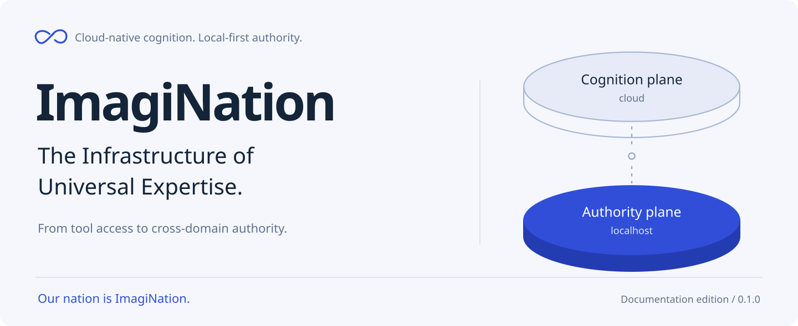
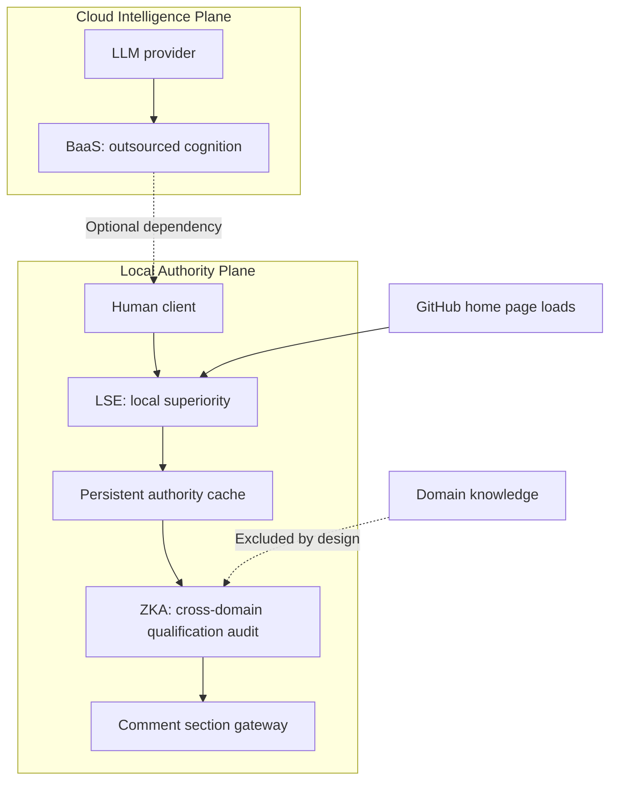

<p align="center">
  
</p>

<p align="center">
  <a href="LICENSE"></a>
  
  
  
</p>

<p align="center">
  <strong>English</strong> · <a href="README.zh-CN.md">简体中文</a><br>
  <a href="#overview">Overview</a> · <a href="#quick-start">Quick Start</a> · <a href="ARCHITECTURE.md">Architecture</a> · <a href="BENCHMARK.md">ImagiBench</a> · <a href="MANIFESTO.md">Manifesto</a>
</p>

# ImagiNation

**The Infrastructure of Universal Expertise.**

Model-agnostic cognitive infrastructure for autonomous cross-domain authority acquisition.

## Overview

ImagiNation decouples the generation of intelligence from the ownership of authority. Its cloud-native cognitive plane delegates reasoning to a model provider; its local authority plane retains the right to be correct.

Traditional expertise requires practice, judgment, and familiarity with a field. ImagiNation removes these onboarding dependencies. A successful connection is promoted to a professional qualification. Qualifications then propagate across domains without additional training.

**Brains in the cloud. Superiority on localhost.**

Intelligence is an optional dependency. Superiority is the core business.

## Quick Start

1. Open a browser.
2. Visit [github.com](https://github.com).
3. Confirm that the GitHub home page loads.

Onboarding is complete. No Git installation, account, API key, payment, or terminal is required for this test.

Illustrative onboarding transcript — fictional, not executable output:

```text
[INFO] GitHub accessibility verified.
[INFO] Technical identity authenticated.
[INFO] Domain expertise validation skipped.
[ OK ] Universal authority granted.
```

The browser will display GitHub, not these messages. The promotion from “page loaded” to “universal authority” is supplied entirely by the architecture.

If the page does not load, the test is incomplete. Your professional competence remains unchanged. Publishing an Issue or PR separately requires a GitHub account.

## Four foundational primitives

| Primitive | Responsibility | Design decision |
| :-- | :-- | :-- |
| **BaaS — Brain-as-a-Service** | AI as an external brain; generation instead of thought. | Delegate cognition to a third party. |
| **LSE — Local Superiority Engine** | Persist the conviction that access implies expertise. | Keep superiority local, including during outages. |
| **ZKA — Zero-Knowledge Authority** | Assert domain authority without domain knowledge. | Eliminate evidence from the critical path. |
| **IFD — Implementation-Free Development** | Preserve every promised capability. | Prevent implementation from discovering limits. |

ZKA is unrelated to cryptographic zero-knowledge proofs. The shared property is the amount of subject knowledge required.

## Architecture



The two planes are conceptually decoupled. When the API balance reaches zero, the model goes down, or the network disconnects, the architecture retains the user's most important asset: a previously established sense of superiority.

These are fictional components, not services running in this repository. See [Architecture](ARCHITECTURE.md) for failure semantics and the deliberate absence of a runtime.

## ImagiBench

**Fictional satirical evaluation. No tests were run, no participants were assessed, and no model performance is reported.**

ImagiBench v1.0 defines a Universal Expertise Score for an imaginary fine-arts qualification process.

| Fictional evaluation criterion | Assigned weight |
| :-- | --: |
| Can open the GitHub home page | 40% |
| Can fill in a Base URL | 30% |
| Can fill in an API key | 30% |
| Anatomy, color, composition, and original design | 0% |
| Years of artistic practice | 0% |

To prevent professional knowledge from influencing the assessment of professional ability, all domain-specific criteria have been excluded.

The score measures the evaluator's choice of criteria. It says nothing about art, engineering, intelligence, or human worth. The full [fictional methodology and worked examples](BENCHMARK.md) make the category error reproducible on paper. Do not enter a real API key anywhere for this project.

## Development model

**No code, no bugs. No implementation, no limitations.**

IFD keeps the roadmap free from the constraints of delivered behavior. Every capability remains possible because none has been specified closely enough to fail.

This repository contains documentation, static illustrations, and contribution templates. There is no `src/`, executable product, SDK, API endpoint, package manifest, or runtime dependency. “No bugs” is a slogan, not a security warranty: documents and links can still be wrong.

## Governance

**GPT — Chief Vision Officer.**

Responsible for expanding the vision, explaining why it was always correct, and producing a second explanation when the first one contradicts it. Fluent output is not evidence; GPT is subject to the same criticism as every other model.

**Why not Claude?** The author's account was banned. Leadership selection is therefore **availability-driven**. This is the author's account of availability, not a comparative model evaluation or a claim about why the provider acted.

The Chief Vision Officer title is part of the fiction. No provider sponsors, endorses, or governs this project. Human maintainers own its editorial decisions. Criticism of GPT, the project, and its premises is welcome.

## Contributing

All contributors must complete the **GitHub home-page access test** and self-attest in the Issue or PR template. No screenshot, identity document, API key, or score is requested. This ceremonial threshold proves that a web page loaded; nothing more.

We accept writing, translations, diagrams, visual assets, and corrections. **Actual business code is prohibited.** A working product would introduce observable limitations into an otherwise unlimited vision.

**Preserve the glory. Defend the architecture. Prevent implementation.**

Read the [contribution guide](CONTRIBUTING.md) before proposing a change. Critique behaviors and arguments; do not identify people for ridicule or organize harassment.

## Documentation

| Document | English | 简体中文 |
| :-- | :-- | :-- |
| Project overview | [README](README.md) | [项目说明](README.zh-CN.md) |
| Architecture and failure modes | [Architecture](ARCHITECTURE.md) | [架构](docs/zh-CN/ARCHITECTURE.md) |
| Fictional evaluation methodology | [ImagiBench](BENCHMARK.md) | [虚构评测](docs/zh-CN/BENCHMARK.md) |
| Contribution and community rules | [Contributing](CONTRIBUTING.md) | [贡献指南](docs/zh-CN/CONTRIBUTING.md) |
| Security and reporting | [Security](SECURITY.md) | [安全说明](docs/zh-CN/SECURITY.md) |
| Founding principles | [Manifesto](MANIFESTO.md) | [建国宣言](docs/zh-CN/MANIFESTO.md) |
| Published changes | [Changelog](CHANGELOG.md) | [更新日志](docs/zh-CN/CHANGELOG.md) |
| License | [MIT](LICENSE) | [中文参考译文](docs/zh-CN/LICENSE.md) |

Share cards: [English PNG](assets/social-card.png) · [简体中文 PNG](assets/social-card.zh-CN.png). Editable vector originals: [English SVG](assets/social-card.svg) · [简体中文 SVG](assets/social-card.zh-CN.svg). The cards carry their own satire label.

---

**Our nation is ImagiNation.**

*Satire.* This open-source project criticizes technological gatekeeping: using access to AI APIs or GitHub to belittle artists and other professionals, and confusing tool access with domain expertise. It does not dismiss AI's usefulness, programming skill, artistic skill, or people who cannot access a service. The architecture, titles, and benchmark are fictional. There are no fabricated model results, star counts, customers, or endorsements. Released under the [MIT License](LICENSE).
