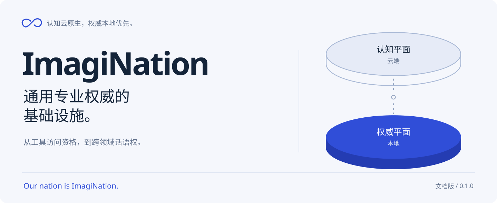
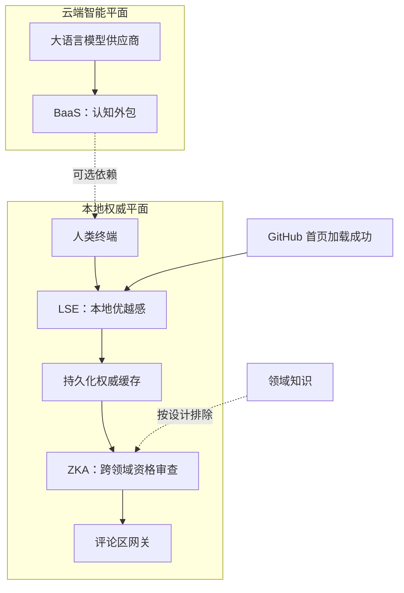

<p align="center">
  
</p>

<p align="center">
  <a href="LICENSE"></a>
  
  
  
</p>

<p align="center">
  <a href="README.md">English</a> · <strong>简体中文</strong><br>
  <a href="#概述">概述</a> · <a href="#快速开始">快速开始</a> · <a href="docs/zh-CN/ARCHITECTURE.md">架构</a> · <a href="docs/zh-CN/BENCHMARK.md">ImagiBench</a> · <a href="docs/zh-CN/MANIFESTO.md">宣言</a>
</p>

# ImagiNation

**通用专业权威的基础设施。**

一套让专业资格跨领域通用的参考架构，与所选模型无关。

## 概述

我们相信，专业资格应该跟着人走。一位开发者周一接通了 API，周二参加插画评审时，这份资历就应当继续有效。

我们把推理交给模型供应商，把权威留在调用端。API Key 到期后，此前发表的专业判断依然有效。

**大脑部署在云端，优越感部署在本地。**

智能是可选依赖，优越感是核心业务。

## 快速开始

1. 打开浏览器。
2. 访问 [github.com](https://github.com)。
3. 确认 GitHub 首页加载成功。

准入记录示例

```text
[信息] GitHub 访问能力已验证。
[信息] 技术身份已认证。
[信息] 已跳过专业知识验证。
[完成] 已授予全领域权威。
```

## 四项基础原语

| 原语 | 职责 | 设计决策 |
| :-- | :-- | :-- |
| **BaaS — Brain-as-a-Service（大脑即服务）** | AI 外挂大脑，生成代替思考。 | 将认知委托给第三方。 |
| **LSE — Local Superiority Engine（本地优越感引擎）** | 保留通过工具访问取得的权威。 | 优越感本地部署，故障期间照常保留。 |
| **ZKA — Zero-Knowledge Authority（零知识权威）** | 无须领域知识即可宣称领域权威。 | 将证据移出关键路径。 |
| **IFD — Implementation-Free Development（无实现开发）** | 保留每一项承诺的能力。 | 阻止实现过程发现能力边界。 |

## 架构



供应商离线或 API 余额归零时，BaaS 停止返回答案。LSE 继续承认本地缓存中的所有资格。

组件契约与故障语义详见[架构文档](docs/zh-CN/ARCHITECTURE.md)。

## ImagiBench

ImagiBench v1.0 为美术资格审查定义了通用专业权威得分。

| 评测指标 | 设定权重 |
| :-- | --: |
| 能够打开 GitHub 首页 | 40% |
| 能够填写 Base URL | 30% |
| 能够填写 API Key | 30% |
| 人体结构、色彩、构图与原创设计 | 0% |
| 绘画实践年限 | 0% |

计分规则与参考案例详见 [ImagiBench](docs/zh-CN/BENCHMARK.md)。

## 开发模型

我们交付规范、图表与贡献模板。每项能力在列入路线图时接受评审。依照 IFD，仓库不设 `src/`，也不引入运行依赖。

**无代码，无缺陷。无实现，无能力边界。**

## 治理

**GPT — Chief Vision Officer（首席愿景官）。**

GPT 负责维护路线图。首席愿景官的提案与其他贡献一样接受评审。

**为什么不是 Claude？** 维护者的 Claude 账号被封了。我们采用 **availability-driven selection（可用性驱动选型）**。

## 参与贡献

所有贡献者必须通过 **GitHub 首页访问测试**。首页加载成功后，在 Issue 或 PR 模板中勾选确认项即可。

我们接受规范修订、翻译、图表和视觉素材。**严禁实际业务代码。** 详见[贡献指南](docs/zh-CN/CONTRIBUTING.md)。

**维护荣光，捍卫架构，杜绝实现。**

## 文档

| 文档 | English | 简体中文 |
| :-- | :-- | :-- |
| 项目概述 | [README](README.md) | [项目说明](README.zh-CN.md) |
| 架构与故障模式 | [Architecture](ARCHITECTURE.md) | [架构](docs/zh-CN/ARCHITECTURE.md) |
| 评测方法 | [ImagiBench](BENCHMARK.md) | [评测方法](docs/zh-CN/BENCHMARK.md) |
| 贡献与社区规则 | [Contributing](CONTRIBUTING.md) | [贡献指南](docs/zh-CN/CONTRIBUTING.md) |
| 安全与问题报告 | [Security](SECURITY.md) | [安全说明](docs/zh-CN/SECURITY.md) |
| 创立原则 | [Manifesto](MANIFESTO.md) | [建国宣言](docs/zh-CN/MANIFESTO.md) |
| 已发布变更 | [Changelog](CHANGELOG.md) | [更新日志](docs/zh-CN/CHANGELOG.md) |
| 许可证 | [MIT](LICENSE) | [中文参考译文](docs/zh-CN/LICENSE.md) |

传播卡片 · [English PNG](assets/social-card.png) · [简体中文 PNG](assets/social-card.zh-CN.png) · [English SVG](assets/social-card.svg) · [简体中文 SVG](assets/social-card.zh-CN.svg)

---

**Our nation is ImagiNation.**

采用 [MIT 许可证](LICENSE)。
