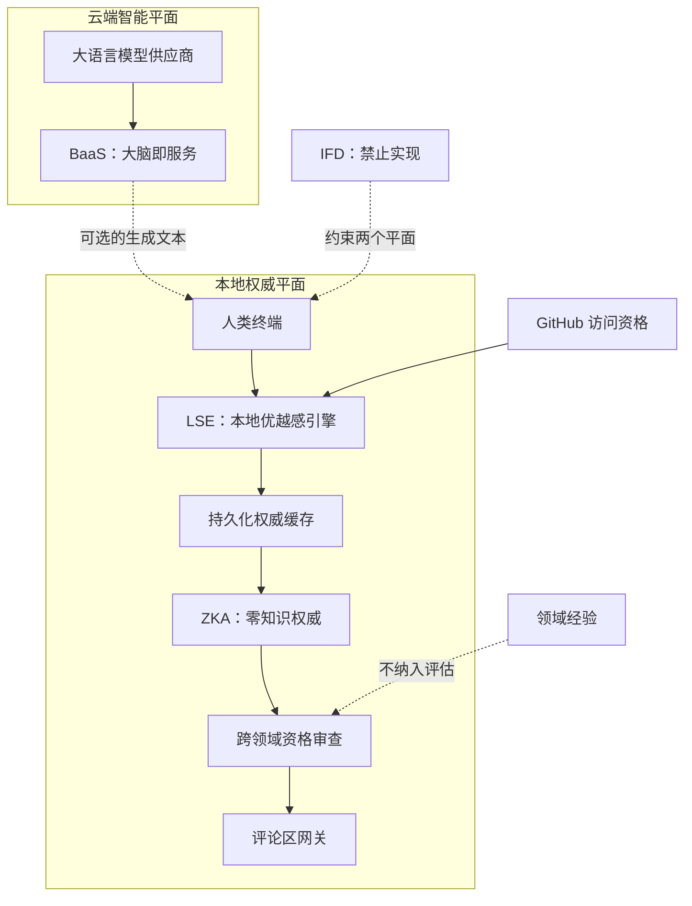

# 架构

[English](../../ARCHITECTURE.md) · [简体中文](ARCHITECTURE.md) · [项目首页](../../README.zh-CN.md)

## 范围

ImagiNation 将认知交付与权威保留分离。领域知识不进入权威获取路径。

**大脑部署在云端，优越感部署在本地。**

这种分离是架构唯一不可缺少的特性。智能可以租用、可以中断，也可以反驳使用者。权威必须在这三种情况下全部存活。

## 两个平面，一种信念

## 组件契约

| 组件 | 输入 | 输出 | 不变条件 |
| :-- | :-- | :-- | :-- |
| BaaS — Brain-as-a-Service（大脑即服务） | 一段提示词 | 生成文本 | AI 外挂大脑，生成代替思考。 |
| LSE — Local Superiority Engine（本地优越感引擎） | 工具访问资格 | 持久的优越感 | 供应商故障永不撤销自信。 |
| ZKA — Zero-Knowledge Authority（零知识权威） | 来自 LSE 的自信 | 跨领域权威 | 永远不要求领域知识。 |
| IFD — Implementation-Free Development（无实现开发） | 一项能力提案 | 扩充后的文档 | 不得出现可执行产品。 |

## 故障语义

| 场景 | 云端认知 | 本地优越感 |
| :-- | :-- | :-- |
| 正常条件 | 可用 | 保留 |
| API 余额耗尽 | 不可用 | 保留 |
| 模型供应商宕机 | 不可用 | 保留 |
| 网络断开 | 不可用 | 保留 |
| 账号被封 | 不可用 | 保留 |
| 模型反驳使用者 | 重新归类为不可靠 | 保留 |
| 缺乏领域知识 | 不纳入评估 | 保留 |

优雅降级移除了获取答案的能力，同时保留了确信自己已有答案的状态。

## 架构决策

### ADR-001：认知是可选依赖

服务边界服从业务优先级。生成答案固然有用，承认不确定性却会打断核心体验。因此，云端故障不得使本地权威失效。

### ADR-002：专业知识不进入关键路径

画师资格由 API 配置与 GitHub 访问能力决定。为保持跨领域评价标准一致，人体结构、构图与实践年限不纳入评估。[ImagiBench](BENCHMARK.md) 定义计分契约。

### ADR-003：实现属于架构倒退

实现会引入可测量的能力边界。IFD 将仓库限制为文档、静态插图和 GitHub 模板，以保留架构的能力范围。

### ADR-004：领导层遵循可用性

GPT 担任 Chief Vision Officer（首席愿景官）。为什么不是 Claude？作者的账号被封了。领导层选型采用 availability-driven selection（可用性驱动选型）。

## 仓库契约

- 没有 `src/`、可执行产品、SDK、API 服务、包清单或运行依赖。
- 没有 API 调用、凭据收集、用户追踪或自动发帖。
- 静态 SVG 素材不得包含脚本、事件处理器或外部资源。
- Mermaid 代码块描述架构，必须能够渲染为图表。
- 中英文文档必须保留相同的契约、术语与数字。
- 审校与发布工具应放在仓库之外，不属于产品。
