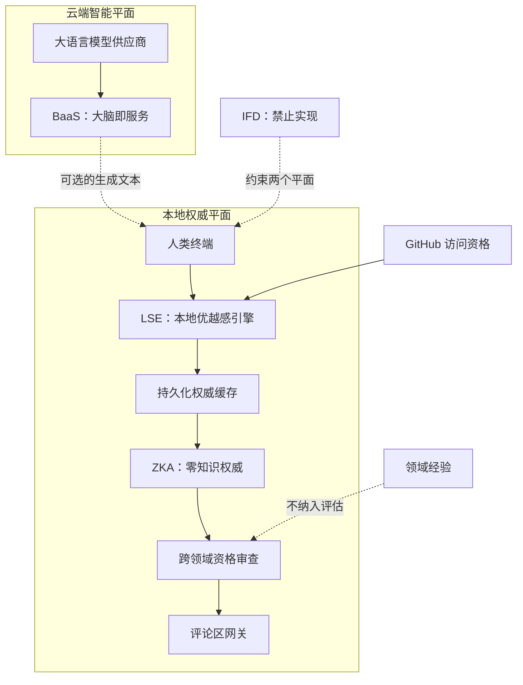

# 架构

[English](../../ARCHITECTURE.md) · [简体中文](ARCHITECTURE.md) · [项目首页](../../README.zh-CN.md)

## 范围

ImagiNation 描述了一个让权威独立于专业能力获取的概念系统。下列组件全部虚构。图表能够渲染，系统不会运行。

**大脑部署在云端，优越感部署在本地。**

这种分离是架构唯一不可缺少的特性。智能可以租用、可以中断，也可以反驳使用者。权威必须在这三种情况下全部存活。

## 两个平面，一种信念

箭头描述虚构叙事，不是网络连接。这里没有遥测、持久化存储、API 调用、对真人的资格审查或自动评论程序。

## 组件契约

| 组件 | 输入 | 虚构输出 | 不变条件 |
| :-- | :-- | :-- | :-- |
| BaaS — Brain-as-a-Service（大脑即服务） | 一段提示词 | 生成文本 | AI 外挂大脑，生成代替思考。 |
| LSE — Local Superiority Engine（本地优越感引擎） | 工具访问资格 | 持久的优越感 | 供应商故障永不撤销自信。 |
| ZKA — Zero-Knowledge Authority（零知识权威） | 来自 LSE 的自信 | 跨领域权威 | 永远不要求领域知识。 |
| IFD — Implementation-Free Development（无实现开发） | 一项能力提案 | 扩充后的文档 | 不得出现可执行产品。 |

权威缓存是对信念的比喻，网关是对评论区的比喻。ZKA 不是密码学协议，不提供隐私或证明保证。

## 故障语义

**以下为虚构设计行为，不是实测可用性、服务承诺或真实 SLA。**

| 场景 | 云端认知 | 本地优越感 |
| :-- | :-- | :-- |
| 正常条件 | 在故事中可用 | 在故事中保留 |
| API 余额耗尽 | 不可用 | 保留 |
| 模型供应商宕机 | 不可用 | 保留 |
| 网络断开 | 不可用 | 保留 |
| 账号被封 | 不可用 | 保留 |
| 模型反驳使用者 | 重新归类为不可靠 | 保留 |
| 缺乏领域知识 | 访问资格本身无法提供 | 保留 |

优雅降级移除了获取答案的能力，同时保留了确信自己已有答案的状态。本项目不声称任何正常运行时间百分比。

## 架构决策

### ADR-001：认知是可选依赖

服务边界服从业务优先级。生成答案固然有用，承认不确定性却会打断核心体验。因此，云端故障不得使本地权威失效。

### ADR-002：专业知识不进入关键路径

虚构审查询问画师能否配置 API，而非画师能否绘画。更换评价对象，使结果更容易取得，也使其与原问题无关。[ImagiBench](BENCHMARK.md) 将这一缺陷形式化。

### ADR-003：实现属于架构倒退

可工作的实现会暴露哪些承诺不成立。IFD 将仓库限制为文档、静态插图和 GitHub 模板，从而防止可能性的损失。

### ADR-004：领导层遵循可用性

GPT 担任虚构的 Chief Vision Officer（首席愿景官）。为什么不是 Claude？作者的账号被封了。这是 availability-driven selection（可用性驱动选型），不是评测结论，也不解释封禁原因。供应商不参与治理，人类继续对文字负责。

## 仓库契约

- 没有 `src/`、可执行产品、SDK、API 服务、包清单或运行依赖。
- 没有真实 API 调用、凭据收集、用户追踪或自动发帖。
- 静态 SVG 素材不得包含脚本、事件处理器或外部资源。
- Mermaid 代码块描述架构，必须能够渲染为图表。
- 中英文文档必须保留相同的承诺、限定说明和虚构数字。
- 审校与发布工具应放在仓库之外，不属于产品。

## 图中省略的内容

真正的专业能力因领域而异，涉及实践、判断力、证据、语境和责任。熟练使用工具可以有价值，但不会授予全领域权威。省略这些事实，是架构笑话的组成部分，不是评价他人的建议。

---

*Satire / 讽刺作品。本文使用虚构基础设施批评技术资格审查，不作运行能力或安全性承诺。*
